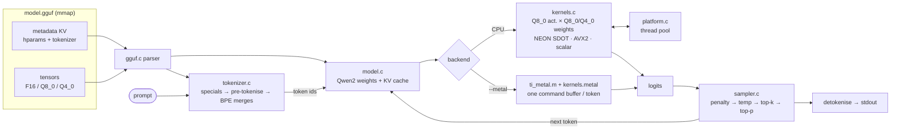

# tinyinfer

**An LLM inference engine written from scratch in C11: GGUF loader, byte-level
BPE tokenizer, Qwen2 transformer, KV cache, Q8_0/Q4_0 quantisation, SIMD
matmul kernels (NEON/SDOT for Apple Silicon, AVX2 for x86), a thread pool,
sampling, and a Metal GPU backend.** No dependencies: not ggml, not BLAS, not a
tokenizer library. The target is Qwen2.5-1.5B-Instruct on an M1 MacBook.

```
$ build/tinyinfer -m models/qwen2.5-1.5b-instruct-q8_0.gguf --chat -p "What is a KV cache?" -n 128
```

Every numerical piece is checked against an independent NumPy implementation
of the same model (`python/tinyinfer_ref/`) using tiny, randomly initialised
Qwen2 models that a script in this repo writes to GGUF, so the whole test-suite
runs in seconds with no downloads.

> **Status (honest):** the CPU engine (scalar + AVX2) is implemented and
> tested on Windows/x86-64; the NEON path compiles for `apple_m1` (checked
> with zig) and CI is set up to execute it under qemu and on a macOS arm64
> runner, but the workflow has not run yet (repo not pushed) and it has never
> run on a real M1. The Metal backend is written but has **not been compiled or run**
> (no Mac was available). No real-model numbers or llama.cpp comparisons exist
> yet: see [Hardware validation](#hardware-validation--todo-for-the-author).

## Contents

- [What's implemented](#whats-implemented)
- [Architecture](#architecture)
- [How it works](#how-it-works)
- [Build and run](#build-and-run)
- [Tests](#tests)
- [Results](#results)
- [Hardware validation / TODO for the author](#hardware-validation--todo-for-the-author)
- [Roadmap](#roadmap)

## What's implemented

| component | file | notes |
|---|---|---|
| GGUF v3 reader (mmap, zero-copy) | `src/gguf.c` | all KV value types, arrays, alignment, bounds checks |
| GGUF writer / re-quantiser | `src/quantize_main.c` | `tinyinfer-quantize in.gguf out.gguf q4_0` ("pure" Q4_0, readable by llama.cpp too) |
| byte-level BPE tokenizer | `src/tokenizer.c` | Qwen2 regex pre-tokeniser hand-written in C, merge ranks, special tokens, streaming-safe decode |
| Qwen2 forward pass | `src/model.c` | RMSNorm, NeoX RoPE (theta from file), GQA, QKV bias, SwiGLU, tied/untied embeddings, batched prefill |
| KV cache | `src/model.c` | preallocated f32 `[layer][pos][kv_dim]` |
| quantisation | `src/quant.c` | Q8_0 / Q4_0 quantise + dequantise, bit-exact with ggml; fp16 <-> fp32 by hand |
| matmul kernels | `src/kernels.c` | F32, F16, BF16, Q8_0, Q4_0 weights; int8 dot products; NEON (+SDOT), AVX2 (+F16C), scalar; 4-token blocked prefill kernel |
| thread pool | `src/platform.c` | pthreads or native Win32, spin-then-sleep, dynamic chunking |
| sampling | `src/sampler.c` | greedy, temperature, top-k (heap), top-p (with pre-filter), repetition penalty, seeded xorshift |
| CLI | `src/main.c` | prompt / chat template / streaming / prefill + decode tok/s / `--bench pp,tg` |
| Metal backend | `metal/ti_metal.m`, `metal/kernels.metal` | matvec f32/f16/q8_0/q4_0, RMSNorm, RoPE, softmax-attention, SwiGLU; one command buffer per token. **Unverified.** |
| NumPy reference | `python/tinyinfer_ref/` | GGUF reader/writer, quant formats, BPE (+ trainer), Qwen2 forward |
| scripts | `scripts/` | random-model generator, Qwen download, llama.cpp benchmark, HF validation |

## Architecture



One decoder layer, as computed in `forward_chunk` (`src/model.c`):

```
x ──┬─► RMSNorm ─► Wq·+bq ─► RoPE ─┐
    │            ─► Wk·+bk ─► RoPE ─┼─► KV cache[l][pos] ─► softmax(qKᵀ/√d)·V ─► Wo ─┐
    │            ─► Wv·+bv ─────────┘          (GQA: head h reads kv head h/g)    │
    └───────────────────────────────────────────────────────────────────── (+) ◄──┘
                                                                           │
h ──┬─► RMSNorm ─► Wgate ─► SiLU ─┐                                         ▼
    │            ─► Wup   ────────(×)─► Wdown ─────────────────────────────(+) ─► x'
    └──────────────────────────────────────────────────────────────────────┘
```

## How it works

**RMSNorm.** `y = x / sqrt(mean(x²) + ε) · g` (sum of squares accumulated in
double).

**RoPE (NeoX layout).** Qwen2 GGUFs use the "rotate halves" convention: for
`i < d/2` the pair `(x[i], x[i + d/2])` is rotated by `θ_i = pos · base^(-2i/d)`,

```
x[i]       ← x[i]·cos θ_i − x[i+d/2]·sin θ_i
x[i + d/2] ← x[i]·sin θ_i + x[i+d/2]·cos θ_i
```

with `base = qwen2.rope.freq_base` (1,000,000 for Qwen2.5). Applying it to
`q` and `k` makes `q·k` depend only on the relative distance between positions.

**Grouped-query attention.** 12 query heads share 2 KV heads in
Qwen2.5-1.5B: query head `h` uses KV head `h / (n_heads / n_kv_heads)`, which
cuts the KV cache 6x (56 KiB per token instead of 336 KiB). Scores are
`q·k / √d` with a causal mask; the softmax is computed in one pass
("online softmax", the same rescaling trick FlashAttention uses):
`m' = max(m, s)`, `l' = l·e^(m−m') + e^(s−m')`, `acc' = acc·e^(m−m') + e^(s−m')·v`.

**SwiGLU MLP.** `down(SiLU(gate·x) ⊙ up·x)`, `SiLU(z) = z / (1 + e^−z)`.

**Block quantisation.** 32 weights share one fp16 scale. Q8_0 stores
`round(x/d)` in int8 (8.5 bits/weight); Q4_0 stores 4-bit levels `q` with
`x ≈ d·(q − 8)` (4.5 bits/weight). For a quantised matmul the activation
vector is itself quantised to Q8_0, so each 32-element block becomes one
integer dot product and one float multiply:

```
y[r] = Σ_b  d_w[r,b] · d_x[b] · Σ_{j<32} q_w[r,b,j] · q_x[b,j]
```

On M1 the inner sum is two `SDOT` instructions per block; on x86 it is
`maddubs`+`madd` with the sign trick. Decoding is memory-bound - every
weight is read once per token - so the format's bytes/weight sets the speed
limit: for Qwen2.5-1.5B (~1.5 B weights) that is ~1.65 GB/token in Q8_0 and
~0.87 GB/token in Q4_0. At the M1's ~68 GB/s that is a ceiling of roughly
40 tok/s (Q8_0) / 75 tok/s (Q4_0) - arithmetic, not a measurement.

**Tokenizer.** Byte-level BPE: specials split out first, then a hand-written
matcher for Qwen2's pre-tokenisation regex, GPT-2's byte→unicode map, and
repeated lowest-rank merges. Details, including the known approximation of
Unicode categories, are in [docs/internals.md](docs/internals.md).

**Sampling.** Repetition penalty (CTRL-style, over the last N tokens) →
temperature → top-k (O(V log k) heap) → top-p (nucleus; without top-k,
tokens with `p < (1−top_p)/(V−1)` are dropped before sorting since they can
never be in the nucleus) → draw with a seeded xorshift64* RNG.

**Threading.** Matmul rows are split over a persistent thread pool
(pthreads, or Win32 threads on Windows), and prompt tokens are processed in
chunks of 64 so weights are reused while they are in cache. See
[docs/internals.md](docs/internals.md) for the pool's synchronisation design.

## Build and run

Requirements: a C11 compiler. Python 3 + NumPy only for tests/scripts.

**macOS (Apple Silicon)**

```bash
make                 # build/tinyinfer, tinyinfer-quantize, test_core, bench_kernels, libtinyinfer.dylib
make metal           # build/tinyinfer-metal (needs Xcode command line tools; shaders compile at start-up)
make test            # C tests + Python tests
```

**Linux**: same `make` / `make test` (uses `-march=native`; `make ARCH=` for a
portable scalar build).

**Windows / anywhere without make**: `build.py` finds `$CC`, `zig cc`
(`pip install ziglang`) or `cc/gcc/clang`:

```bash
pip install -r requirements-dev.txt ziglang
python build.py                 # native SIMD
python build.py --portable      # scalar baseline
python build.py --check-neon    # compile the core for apple_m1 / cortex-a72 with zig (no link)
python build.py --target aarch64-linux-musl --mcpu cortex_a76 --only test_core   # cross build
```

**Get a model and run**

```bash
scripts/download_qwen.sh            # Qwen2.5-1.5B-Instruct Q8_0 -> models/ (+ pure Q4_0 copy)
build/tinyinfer -m models/qwen2.5-1.5b-instruct-q8_0.gguf -p "The capital of France is" -n 64 --temp 0
build/tinyinfer -m models/qwen2.5-1.5b-instruct-q8_0.gguf --chat -p "Explain RoPE briefly." -n 256
build/tinyinfer-metal -m models/qwen2.5-1.5b-instruct-q8_0.gguf --metal --chat -p "Hi" -n 64
```

The CLI prints the generated text on stdout and timing on stderr:

```
[tinyinfer] prefill: N tokens in X ms (Y tok/s)
[tinyinfer] decode:  M tokens in X ms (Y tok/s)
```

Options: `-n` tokens, `-t` threads, `-c` context, `--temp`, `--top-k`,
`--top-p`, `--repeat-penalty`, `--repeat-last-n`, `-s` seed, `--chat`,
`--system`, `--ignore-eos`, `--bench PP,TG`, `-v`.

No model? `python scripts/make_tiny_model.py -o build/tiny.gguf --type q4_0`
writes a random 2-layer Qwen2 with a real trained BPE tokenizer
(gibberish output, but it exercises everything). `--preset qwen2.5-1.5b`
writes random weights with the *real* shapes for speed tests (~1.6 GB file).

## Tests

```bash
python build.py && python -m pytest -q tests     # or: make test
build/test_core                                   # dependency-free C tests
```

What is tested (all against independent implementations, not against itself):

| area | how |
|---|---|
| fp16 conversion | all 65,536 half values round-trip; float→half rounding (ties, subnormals, overflow) equals NumPy |
| Q8_0 / Q4_0 | C bytes == NumPy reference bytes (bit-exact); per-element error bounds; RMS error |
| matmul | every weight type × several shapes × 1-64 tokens vs NumPy; 1 vs 4 threads bit-identical; 3,000 back-to-back tiny jobs (pool stress); SIMD vs scalar in C |
| tokenizer | C pre-tokeniser == Python port == **real Qwen2 regex** (via `regex`) on 21 samples + 400 random strings; C BPE == Python BPE; encode→decode round-trip on 200 random Unicode strings; special tokens; UTF-8 split across tokens |
| forward | full logits, C vs NumPy, for F32/F16/Q8_0/Q4_0, tied/untied, GQA/MHA, rope theta 1e4/1e6; KV-cache incremental decode == batch; >64 tokens (multiple prefill chunks); error paths |
| sampler | greedy; temperature distributions vs softmax (20k draws); top-k / top-p support sets; repetition penalty; seed determinism |
| end to end | CLI greedy output == NumPy greedy decode + Python detokeniser; `--bench`; chat + seeded sampling reproducible; `tinyinfer-quantize` output byte-identical to the Python quantiser |
| Metal | GPU logits vs float reference (skipped unless `build/tinyinfer-metal` exists) |

Last local run (Windows 10, Ryzen 5 3600, zig cc 0.17.1 (`pip install ziglang`) via `build.py`):
`168 passed, 5 skipped` (the 5 skipped are the Metal tests); `test_core`:
`112 passed, 0 failed`; the same suite also passes with `--portable` (scalar
kernels). CI (`.github/workflows/ci.yml`) is configured for Linux AVX2 + scalar +
ASan/UBSan, Windows (zig), aarch64 under qemu (NEON/SDOT kernels and a full
forward pass vs NumPy) and a macOS arm64 runner (NEON natively, Metal build);
it has not been run yet, so expect a first-push fix or two.

## Results

### Correctness on the toy models (measured here)

Relative L2 error of the logits vs the F32 model with the same weights
(dim = 64, so each dot product averages very little noise; real models are
better): F16 ≈ 0.1 %, Q8_0 ≈ 3 %, Q4_0 ≈ 29 %. C vs NumPy reference with the
same format: max |Δ| / std(logits) < 1e-5 (F32/F16) and < 2e-2 (Q8_0/Q4_0,
the residual being rare Q8_0 activation-rounding flips).

### CPU speed on this dev machine (NOT an M1, NOT real weights)

Machine: AMD Ryzen 5 3600 (6 cores / 12 threads, Zen 2, AVX2), DDR4,
Windows 10, zig cc `-O2 -march=native`. Models: **random weights with the real
Qwen2.5 shapes** (`make_tiny_model.py --preset ...`; speed does not depend on
the weight values). `tinyinfer --bench PP,TG -t 6 -r 3` (mean of 3):

| shapes (random weights) | weights | file size | pp128 t/s | tg64 t/s |
|---|---|---|---|---|
| Qwen2.5-0.5B | Q8_0 | 529 MB | 154.0 | 40.9 |
| Qwen2.5-0.5B | Q4_0 | 282 MB | 156.6 | 68.5 |
| Qwen2.5-1.5B | Q8_0 | 1.64 GB | 58.2 | 13.5 |
| Qwen2.5-1.5B | Q4_0 | 0.87 GB | 51.8 | 22.5 |

(tg is measured from an empty KV cache, like llama-bench. For Q8_0 1.5B,
13.5 tok/s x 1.64 GB = ~22 GB/s of weight streaming on dual-channel DDR4.)

Kernel micro-benchmark (`build/bench_kernels 6 50`, Qwen2.5-1.5B layer shapes):

| format | shape | decode ms | decode GB/s | prefill-64 GFLOP/s |
|---|---|---|---|---|
| F32 | 1536x1536 (q, o) | 0.053 | 176.8 | 111.5 |
| F16 | 1536x1536 (q, o) | 0.073 | 64.6 | 64.1 |
| Q8_0 | 1536x1536 (q, o) | 0.040 | 62.7 | 173.9 |
| Q4_0 | 1536x1536 (q, o) | 0.041 | 32.1 | 164.0 |
| F32 | 8960x1536 (gate, up) | 2.380 | 23.1 | 120.9 |
| F16 | 8960x1536 (gate, up) | 0.973 | 28.3 | 69.7 |
| Q8_0 | 8960x1536 (gate, up) | 0.221 | 66.2 | 189.3 |
| Q4_0 | 8960x1536 (gate, up) | 0.209 | 37.1 | 181.5 |
| Q8_0 | 1536x8960 (down) | 0.424 | 34.5 | 154.8 |
| Q4_0 | 1536x8960 (down) | 0.184 | 42.1 | 174.6 |

Caveat: a single matrix up to ~14 MB stays in the Ryzen's 32 MB L3 across
iterations, so these GB/s figures exceed DRAM bandwidth; the end-to-end
table above is the realistic one. Q4_0 moves about half the bytes of Q8_0
but spends extra instructions unpacking nibbles, so on cache-resident shapes
its latency is similar and its GB/s lower.

These are only here to show the engine works at real sizes; they say nothing
about the M1 or about llama.cpp.

### tinyinfer vs llama.cpp on M1 (to be filled by `scripts/bench.sh`)

Qwen2.5-1.5B-Instruct, same GGUF file for both engines, pp512 / tg128,
M1 performance cores. **Empty cells = not measured yet.**

| model | backend | test | tinyinfer t/s | llama.cpp t/s | ratio |
|---|---|---|---|---|---|
| Q8_0 | CPU (NEON) | pp512 | run scripts/bench.sh on M1 | run scripts/bench.sh on M1 | |
| Q8_0 | CPU (NEON) | tg128 | run scripts/bench.sh on M1 | run scripts/bench.sh on M1 | |
| Q4_0 (pure) | CPU (NEON) | pp512 | run scripts/bench.sh on M1 | run scripts/bench.sh on M1 | |
| Q4_0 (pure) | CPU (NEON) | tg128 | run scripts/bench.sh on M1 | run scripts/bench.sh on M1 | |
| Q8_0 | Metal | pp512 | run scripts/bench.sh on M1 | run scripts/bench.sh on M1 | |
| Q8_0 | Metal | tg128 | run scripts/bench.sh on M1 | run scripts/bench.sh on M1 | |
| Q4_0 (pure) | Metal | pp512 | run scripts/bench.sh on M1 | run scripts/bench.sh on M1 | |
| Q4_0 (pure) | Metal | tg128 | run scripts/bench.sh on M1 | run scripts/bench.sh on M1 | |

Expectation, so the numbers can be judged when they arrive: llama.cpp has
years of kernel tuning (register-blocked GEMM for prefill, simdgroup-matrix
Metal kernels, flash attention), so tinyinfer is expected to be competitive
on CPU decode (memory-bound, see the bandwidth ceiling above) and clearly
behind on prefill and on Metal.

## Hardware validation / TODO for the author

Nothing in this section has been run yet. Commands are exact; paste the
output into the tables.

1. **Build and test on the M1** (first native run of the NEON + SDOT kernels):

   ```bash
   make && make test
   build/test_core            # expect "... 0 failed", simd path: neon-dotprod
   ```

   | check | result |
   |---|---|
   | `make test` on M1 | |
   | `test_core` simd path | |

2. **Metal backend** (never compiled so far; expect to fix compile errors):

   ```bash
   make metal
   TI_NO_AUTOBUILD=1 python3 -m pytest -q tests/test_cli.py -k metal   # GPU vs NumPy logits
   ```

   | check | result |
   |---|---|
   | `make metal` compiles | |
   | shaders compile at start-up | |
   | 5 Metal tests pass | |

3. **Real model correctness** vs Hugging Face transformers (needs
   `pip install torch transformers`, downloads ~3 GB of HF weights):

   ```bash
   scripts/download_qwen.sh                       # Q8_0 + pure Q4_0
   python3 scripts/validate_hf.py models/qwen2.5-1.5b-instruct-q8_0.gguf
   python3 scripts/validate_hf.py models/qwen2.5-1.5b-instruct-pure-q4_0.gguf
   ```

   | model | tokenizer identical | logits cosine | top-1 match | top-10 overlap |
   |---|---|---|---|---|
   | Q8_0 | | | | |
   | Q4_0 (pure) | | | | |

4. **Sample output** (greedy, for the README):

   ```bash
   build/tinyinfer -m models/qwen2.5-1.5b-instruct-q8_0.gguf --chat --temp 0 -n 128 \
       -p "Explain what a KV cache is in two sentences."
   ```

   <!-- paste output + the prefill/decode tok/s lines here -->

5. **Benchmarks vs llama.cpp** (build llama.cpp with Metal, put `llama-bench`
   on PATH or set `LLAMA_BENCH`):

   ```bash
   scripts/bench.sh models/qwen2.5-1.5b-instruct-q8_0.gguf models/qwen2.5-1.5b-instruct-pure-q4_0.gguf
   # writes bench_results.md -> copy into the table above
   ```

   <!-- screen recording of a chat session here -->

## Roadmap

- [ ] Run everything in the hardware section on an M1; fix the Metal backend.
- [ ] Prefill: register-blocked GEMM tiles (e.g. 4 rows × 4 tokens) instead of
      per-row dot products; Metal batched prefill with `simdgroup_matrix`.
- [ ] f16 KV cache (halves cache bandwidth at long context); KV cache on GPU in f16.
- [ ] Fused kernels on Metal (RMSNorm+matvec, QKV in one dispatch).
- [ ] More formats: Q4_K / Q6_K so the official Q4_K_M files load directly.
- [ ] Qwen3 (QK-norm, no QKV bias) and Llama (interleaved RoPE) architectures.
- [ ] Exact Unicode categories in the pre-tokeniser (generated tables).
- [ ] Speculative decoding with Qwen2.5-0.5B as the draft model.

## Repository layout

```
include/tinyinfer.h        public C API (also used from Python via ctypes)
src/                       engine: gguf, tokenizer, model, kernels, quant, sampler, platform, CLI
metal/                     Metal host (.m) + shaders (.metal)
python/tinyinfer_ref/      NumPy reference: GGUF I/O, quant formats, BPE, Qwen2 forward, ctypes API
scripts/                   make_tiny_model.py, download_qwen.sh, bench.sh, validate_hf.py
tests/                     pytest suite + test_core.c
tools/bench_kernels.c      matmul micro-benchmark
examples/                  generate.py (ctypes API), chat.sh
docs/internals.md          formats and design notes
```

## License

MIT - see [LICENSE](LICENSE).
